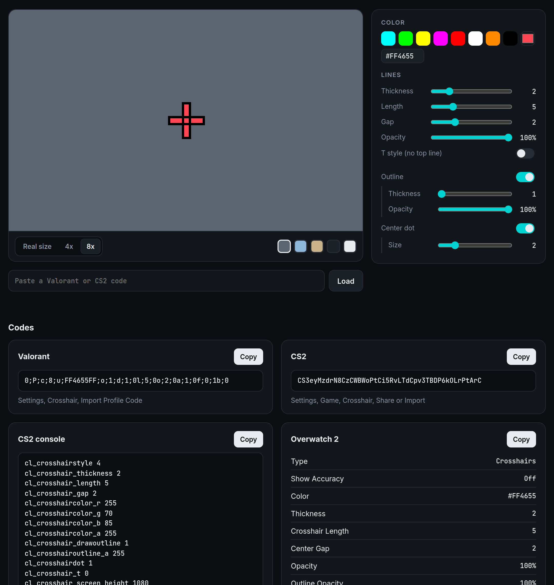

# crosshair

Crosshair maker for Valorant, CS2 and Overwatch 2. Design it once and copy the code for each game, or paste a Valorant or CS2 code to see it and convert it.

**https://salw2e.github.io/crosshair**

To run it locally, serve the folder (`python3 -m http.server`) and open it in a browser.

| Game | Output |
|---|---|
| Valorant | profile code (`0;P;...`) |
| CS2 | share code (`CS...`) and console commands |
| Overwatch 2 | the settings to enter, since it has no codes |

Sizes are pixels at 1080p. The CS2 share code format follows [akiver/csgo-sharecode](https://github.com/akiver/csgo-sharecode) and is checked against its test codes.

Missing: Valorant outer lines and ADS settings, CS2 dynamic styles, Apex and Fortnite (no custom crosshairs)
